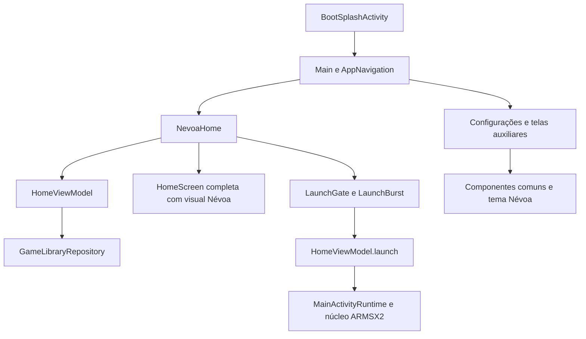

# Arquitetura e mapa do código

[Índice do Névoa](../NEVOA.md)

## Camadas e fluxo

O Névoa aplica sua experiência sobre a interface Android em Jetpack Compose. Não adiciona outro núcleo, repositório de jogos ou serviço remoto próprio.

### Abertura

`BootSplashActivity` escolhe o vídeo padrão ou personalizado. `FillVideoView` preenche a janela. Depois que o vídeo é preparado, o timeout considera sua duração e uma margem, respeitando os limites da Activity. A faixa Névoa Suspense V6 está incorporada no MP4 padrão (AAC), usando o mesmo relógio da imagem. A conclusão audiovisual entrega à Main. Se existir áudio personalizado, a trilha incorporada é silenciada e `IntroSound` toca a substituição com preparação assíncrona. Um vídeo personalizado mantém seu próprio som. Ao sair para segundo plano, vídeo e som param; ao retornar, a abertura interrompida dá lugar à biblioteca. Os players são liberados na saída e na destruição.

`Main` abre sem animação de troca. Seu tema já mostra `nevoa_last_frame.webp`. Durante a carga inicial, `NevoaHome` mantém o fundo; ao receber os jogos, apresenta a fileira. A entrada visual dos elementos toca uma vez por processo.

### Biblioteca

`NevoaHome` chama o carregamento e observa os sinais de atualização existentes. Usa diretamente `HomeViewModel.state.visibleGames`, já filtrado e ordenado. Não concatenar recentes depois desse processamento: isso recolocaria jogos excluídos pela busca e alteraria a ordem escolhida.

Busca chama `setQuery`, ordem chama `setSort`, e o teclado é `LibraryKeyboard`, renderizado pela infraestrutura do runtime. A tela completa, baseada em HomeScreen e agora com visual Névoa, atende preparação da biblioteca e abertura explícita. Consultas sem resultados permanecem em Névoa; a fileira aceita lista vazia sem acesso a índice inexistente.

| Estado | Responsável |
|---|---|
| Jogos, scan, consulta e ordem | `HomeViewModel` e repositório original |
| Seleção | URI em `rememberSaveable` na fileira |
| Pedido de biblioteca clássica | Estado salvo de `NevoaHome` |
| Entrada visual já tocada | Marcador por processo `NevoaEntrance` |
| Início pendente | `LaunchGate`, item pendente e estado de emulação |

### Início de jogo

`LaunchGate` aceita uma tentativa e `LaunchBurst` mostra a transição: 900 ms, com a capa partindo de seu retângulo medido até uma apresentação central, título, fundo Névoa escurecido e fechamento em preto. A camada consome toque e os callbacks bloqueiam ações concorrentes. Ao terminar, `HomeViewModel.launch` registra recentes e encaminha o item ao runtime. A cobertura escura final permanece enquanto a inicialização assíncrona ainda deixa o runtime em STOPPED, evitando expor a biblioteca entre animação e jogo.

O círculo branco e as partículas da antiga explosão foram removidos. O gate usa o estado de emulação e um timeout para reabrir. A preservação integral da transição durante recriação de Activity continua pendente.

### Fundo e ciclo de vida

Android 13 ou superior usa `RuntimeShader`/AGSL. Versões anteriores e falhas de compilação usam gradiente estático. O relógio só avança com o ciclo de vida em `RESUMED` e fora de emulação `RUNNING` ou `PAUSED`.

O intervalo mínimo atual é 30.000.000 ns; o vsync determina a cadência efetiva. O tempo tem wrap de 600 segundos. O modo `calm` reduz movimento e brilho nas telas de trabalho.

### Controle e foco

O caminho principal é `MainActivityRuntime.dispatchKeyEvent` → `SettingsControllerNav`. A fileira registra confirmar e movimentos horizontais; botões usam `controllerFocusable` e posições medidas para navegação espacial. O teclado tem prioridade quando visível. Não depender apenas do foco Android/Compose.

Usar `PadModal`, `ConfirmOverlay` e `NotifyOverlay` para overlays. A tarefa `checkNoWindowModals`, ligada a `preBuild`, bloqueia os padrões de janelas Compose que roubam a entrada do gamepad.

## Implementações Névoa

Base dos caminhos: `platforms/android/app/src/main/java/com/armsx2/nevoa/`.

| Arquivo | Responsabilidade |
|---|---|
| `NevoaStrings.kt` | Textos PT-BR fixos do Névoa |
| `theme/NevoaPalette.kt` | Paleta, ColorScheme, tipografia e cores legadas |
| `theme/Contrast.kt` | Cálculos de contraste |
| `background/NevoaBackground.kt` | Relógio, modo calmo e fallback |
| `background/NevoaShader.kt` | Cena AGSL |
| `home/NevoaLibraryChrome.kt` | Cabeçalho e ações discretas da biblioteca completa |
| `home/NevoaHome.kt` | Tela, fileira, busca, ordem e integração de entrada |
| `home/LibraryLogic.kt` | Seleção, fallback e rótulos |
| `home/DvdCase.kt` | Caixa, capa, seleção e brilho |
| `home/GameDetailsPanel.kt` | Dados e ações do jogo; botões compartilhados da biblioteca |
| `home/LaunchBurst.kt` | Gate e transição de início |
| `intro/NevoaOrientation.kt` | Mapeia o padrão antigo de orientação para paisagem, preservando escolhas explícitas |
| `intro/FillVideoView.kt` | Preenchimento do vídeo |
| `intro/IntroSound.kt` | Validação, cópia e reprodução de áudio |
| `settings/SettingsGroups.kt` | Agrupamento das categorias existentes |

## Integrações alteradas no ARMSX2

Base dos caminhos Kotlin: `platforms/android/app/src/main/java/com/armsx2/`.

| Área | Arquivos principais |
|---|---|
| Entrada | `BootSplashActivity.kt`, `Pasx2Application.kt`, `navigation/AppNavigation.kt` |
| Biblioteca completa | `ui/home/HomeScreen.kt` |
| Gaveta | `navigation/NavigationDrawer.kt` |
| Tema | `ui/theme/Theme.kt` |
| Componentes | `ui/common/ArmsComponents.kt`, `ui/common/SettingControls.kt`, `ui/settings/SettingsWidgets.kt` |
| Configurações | `ui/settings/AppTab.kt`, `ui/settingshub/SettingsScreen.kt`, `ui/settingshub/SettingsSearchIndex.kt` |
| BIOS, cartões e saves | `ui/bios/BiosManagerScreen.kt`, `ui/memorycards/MemoryCardScreen.kt`, `ui/saves/SaveManagerScreen.kt` |
| Controles | `ui/controls/ControllerManagerScreen.kt` |
| Patches e texturas | `ui/patches/PatchManagerScreen.kt`, `ui/textures/TextureManagerScreen.kt`, `ui/textures/TextureOnlineSection.kt` |
| Conquistas e pausa | `ui/achievements/AchievementsScreen.kt`, `ui/emulation/EmulationMenuScreen.kt` |
| Mensagens | `ui/WelcomeBanner.kt`, `BatteryWatcher.kt`, `i18n/I18n.kt` |

Também foram alterados `AndroidManifest.xml`, `assets/i18n/pt-BR.json`, `res/values/themes.xml`, `res/layout/activity_boot_splash.xml`, `res/raw/boot_intro.mp4`, `res/raw/nevoa_intro_sound.mp3`, `res/drawable-nodpi/nevoa_last_frame.webp` e `res/drawable/nevoa_window_bg.xml`.

Após novos incrementos, o diff contra a base fornece a lista exata. Mudanças nos componentes comuns podem atingir várias telas; a verificação deve acompanhar esse alcance.

## Dados

Jogos, permissões, configurações, histórico, conquistas e saves permanecem na infraestrutura original. O áudio importado fica em `filesDir/nevoa_intro_sound`, e o vídeo personalizado em `filesDir/bootintro/intro`. São cópias privadas: não dependem do URI de origem após a importação e são removidas se o armazenamento do app for apagado.

O namespace é `com.armsx2`, mas o application ID é `com.armsx2.nevoa`. Por isso, a Activity de abertura via ADB é `com.armsx2.nevoa/com.armsx2.BootSplashActivity`.

A fileira trata gestos horizontais com limiar de 48 dp. O scroll livre foi substituído por um avanço de seleção por gesto, com rolagem animada da lista para acompanhar o URI selecionado. O callback do gesto acompanha a seleção mais recente, também quando ela muda por controle.

A troca de seleção anima altura, brilho e borda da caixa em 320 ms, junto com expansão/recolhimento e fade do painel. O painel que está saindo perde suas ações e seu registro de controle, evitando configuração ou início de um jogo antigo durante a troca. A animação de Jogar recebe uma cópia dos limites da capa no momento do clique; mudanças de layout posteriores não alteram a origem do movimento.

O menu de emulação usa ícones Line Awesome e preserva os IDs de ações no registro de controle. Em paisagem, o conjunto de painel e abas usa até 44% da largura (máximo 520 dp) e 78% da altura. O cabeçalho mostra título, hardcore quando aplicável e atalho de amigos. Serial, CRC e presença são calculados/exibidos sob demanda em Detalhes do jogo, dentro de Mais ações.
`NevoaSection` fornece a seção recolhível compartilhada pelo menu em jogo e estados. `nevoa/saves/SaveSlotFiles.kt` distingue o caminho candidato retornado pelo JNI de um arquivo efetivamente existente antes de habilitar o carregamento.

O título da abertura acompanha o ataque final da V6 em 7,0 s: entrada 6,97–7,10 s, assentamento até 7,15 s e saída 7,50–7,95 s. A linha do tempo está em `tools/nevoa-intro/intro.html`; o relógio audiovisual e a duração de 8 s não mudam. Use `render.mjs --audio-from` para conservar a trilha incorporada ao revisar somente a imagem.

### Arte padrão dos controles de toque

`nevoa/touch/NevoaPadPainter.kt` desenha os botões, direcional e analógicos padrão com contornos e preenchimento discreto na paleta Névoa. O overlay continua dono das posições, tamanhos, gestos, estados de pressão e JNI. As dimensões intrínsecas mantêm as proporções dos PNGs anteriores, usadas pelo espaçamento dos ombros e braços do direcional. A cadeia de skins personalizadas continua tendo prioridade sobre a arte padrão.

O editor usa um painel de até 480 dp, cores Névoa e opções adicionais recolhidas em “Mais opções”. Editar Layout de Toque fica no início da aba Controles do menu em jogo. Nenhuma migração de perfis ou coordenadas foi introduzida.

`FaceButtonPositions.kt` corrige o losango padrão usando as dimensões reais em pixels, em vez de espaçamentos percentuais independentes nos dois eixos. Preserva centro e distância entre vizinhos, tamanhos e demais campos; triângulo acima, círculo à direita, X abaixo e quadrado à esquerda. Só reconhece as posições padrão antigas, preservando posicionamentos personalizados. O overlay aplica o layout corrigido ao estado vivo, compartilhado pelo desenho, editor e hit testing. O ajuste não grava perfis automaticamente; Salvar no editor continua sendo explícito.

### Categorias da biblioteca

`NevoaCategoryFilter` é a faixa horizontal compartilhada pela home e pelos modos Grade, Lista e Estante. Reutiliza `GameCategories` e o JSON `library.categories`, com associação por `GameInfo.settingsKey`; nenhum formato novo ou migração. “Categorias do jogo” abre o editor de associação existente, agora em cartão limitado a 480 dp. Selecionar uma categoria oferece Gerenciar, com renomeação e exclusão confirmada.

`CategoryPool` resolve a categoria válida e os jogos associados antes da busca/ordenação. Categoria existente e vazia mantém a seleção; categoria removida volta a todos os jogos. `HomeViewModel` devolve a categoria resolvida no estado e restringe os recentes ao mesmo conjunto. Mudanças em `GameCategories.version` reconstruem o filtro sem varrer os arquivos de jogos. A seleção é compartilhada entre home e biblioteca completa durante a sessão.

A home usa o registro de navegação de configurações; a biblioteca completa ganhou a zona `HomeZone.Categories` entre Busca e Recentes. A faixa mantém todos os nomes compostos e traz o item focado à área visível, inclusive em listas longas. Voltar não limpa filtros enquanto um modal estiver aberto.
